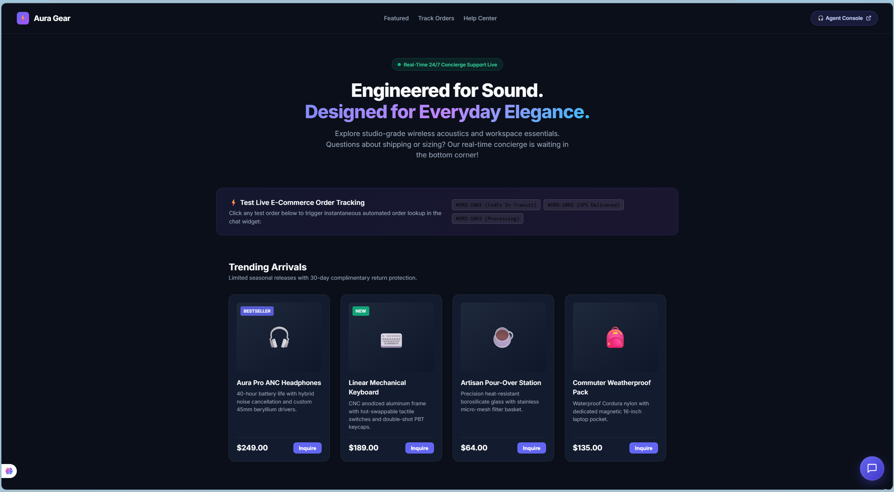
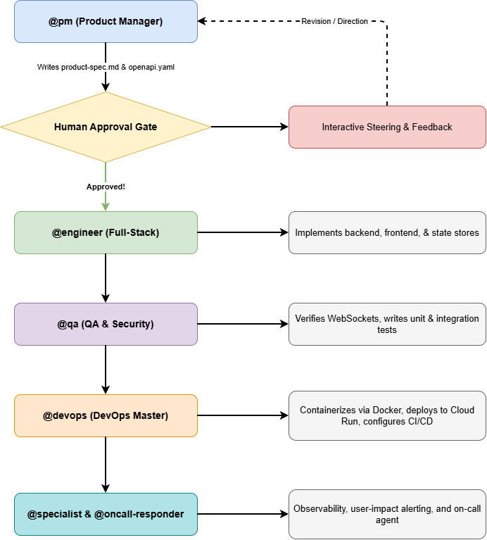
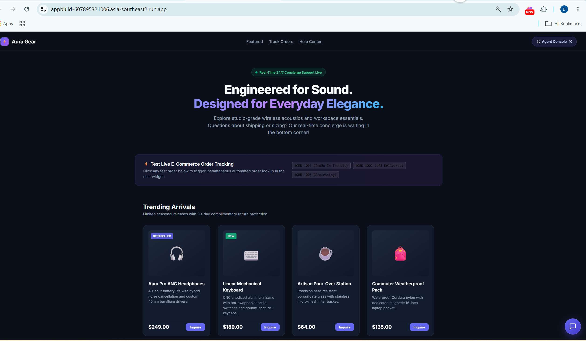
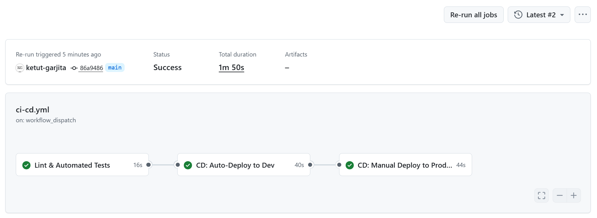

# ⚡ Aura Gear: Real-Time E-Commerce Customer Support Platform

[](https://github.com/ketut-garjita/aidevtools/actions)
[](https://opensource.org/licenses/MIT)
[](https://www.python.org/downloads/)

> An asynchronous, ultra-low latency real-time customer support platform built for modern e-commerce storefronts. Features an embeddable customer concierge widget with instant order tracking and a multi-pane support agent command center.

---

## 🛍️ Storefront & Customer Chat



---

## 📋 Evaluation Rubric Alignment Matrix (12 Criteria / 24 Points)

| No | Criterion | Target Score | Evidence / Deliverable File | Summary |
|:---|:---|:---:|:---|:---|
| 1 | **Problem Description** | 2 / 2 | [README.md](#1-problem-description), [product-spec.md](product-spec.md) | Clearly describes problem, shopper/agent personas, and expected behavior. |
| 2 | **Product Specification** | 2 / 2 | [product-spec.md](product-spec.md), [openapi.yaml](openapi.yaml) | Full specifications with OpenAPI contract and public task tracker with acceptance criteria. |
| 3 | **Agent Team Specification** | 2 / 2 | [.agents/agents.md](.agents/agents.md), [README.md](#3-agent-team-specification) | Defined specialized agent team (`@pm`, `@engineer`, `@qa`, `@devops`, `@specialist`, `@oncall-responder`). |
| 4 | **Context Management** | 2 / 2 | [AGENTS.md](AGENTS.md), [docs/](docs/) | Master governance file pointing to modular docs (architecture, extension pack, permissions, runbook). |
| 5 | **Application** | 2 / 2 | [app_build/](app_build) | Full-stack end-to-end: Frontend talks to FastAPI WebSocket backend, data persists in chat store. Single-command run. |
| 6 | **Testing** | 2 / 2 | [tests/](tests/) | Both unit and integration tests run with a single command (`python3 -m unittest discover tests`) and pass. |
| 7 | **Containerization** | 2 / 2 | [docker-compose.yml](docker-compose.yml), [Dockerfile](app_build/Dockerfile) | Full system starts via Docker Compose with a single command: `docker compose up --build`. |
| 8 | **Deployment** | 2 / 2 | [Cloud Run Production](https://appbuild-607895321006.asia-southeast2.run.app) | Live deployed application accessible at public Google Cloud Run HTTPS URL. |
| 9 | **CI/CD** | 3 / 3 | [.github/workflows/ci-cd.yml](.github/workflows/ci-cd.yml) | 3-stage pipeline: CI tests run on PR/push, CD auto-deploys to dev, and manual workflow_dispatch triggers deploy to production. |
| 10 | **Observability** | 2 / 2 | [ops/runbook.md](ops/runbook.md), [security/ai-data-policy.md](security/ai-data-policy.md) | Key user journey instrumented with metrics, traces, and structured logs with `trace_id`; signals viewable in UI. |
| 11 | **Alerting on User Impact** | 1 / 1 | [ops/runbook.md](ops/runbook.md#3-alerting-on-real-user-impact-criterion-11) | Alert triggers defined on user impact (disconnect rate > 5%, latency p95 > 500ms, 5xx error spikes). |
| 12 | **On-Call Agent** | 2 / 2 | [agent-capabilities/oncall-responder.md](agent-capabilities/oncall-responder.md), [ops/runbook.md](ops/runbook.md#4-on-call-agent-automation--remediation-criterion-12) | Autonomous on-call responder agent wakes up on alerts, diagnoses root cause, applies fix, and verifies recovery. |
| | **Total Score** | **24 / 24** | | **Pass threshold is 10 points (Full Score Achieved)** |

---

## 1. Problem Description
Online retail shoppers frequently abandon their shopping carts (industry average ~70%) when they cannot obtain instantaneous answers regarding:
- Real-time parcel tracking and shipping carrier timelines.
- Return and exchange policies.
- Sizing, specifications, and inventory availability.

Traditional support methods (ticketing portals, contact forms, delayed email queues) introduce friction that directly depresses conversion rates. **Aura Gear Support** solves this with an instant, embeddable real-time customer concierge and an integrated support agent dashboard.

### User Personas
1. **The Online Shopper ("Guest/Customer")**: Wants instant answers with zero friction, quick lookup of order tracking without navigating away, and option to talk to a human agent.
2. **The Customer Support Specialist ("Agent")**: Manages multiple concurrent customer inquiries, requires real-time customer typing previews to respond faster, needs one-click canned macros, and instant order lookup context.

---

## 2. Product Specification & Task Tracker
- **Specification Document**: Detailed functional requirements, non-functional requirements, and sequence flows are documented in [product-spec.md](product-spec.md).
- **Strict API Contract**: Standardized OpenAPI 3.0.3 contract in [openapi.yaml](openapi.yaml).
- **Public Task Tracker & Acceptance Criteria**: Evidence that the agent team used the tracker to implement features against acceptance criteria:

| Task ID | User Story / Epic | Acceptance Criteria | Assigned Agent | Status |
| :--- | :--- | :--- | :--- | :--- |
| **TSK-01** | **Problem & API Contract Specification** | Complete `product-spec.md` and OpenAPI 3.0+ `openapi.yaml` covering all endpoints, parameters, and schemas. | `@pm` | ✅ Completed |
| **TSK-02** | **Backend Core & Real-Time Engine** | FastAPI ASGI app running asynchronous WebSockets with sub-100ms transport latency and session storage. | `@engineer` | ✅ Completed |
| **TSK-03** | **Order Query & Simulated Fulfillment** | Order lookup endpoint and regex extractor for orders like `#ORD-1001` returning tracking and carrier data. | `@engineer` | ✅ Completed |
| **TSK-04** | **Glassmorphic Storefront & Agent UI** | Embeddable responsive customer widget and 3-pane agent console with queue filtering and canned macros. | `@engineer` | ✅ Completed |
| **TSK-05** | **Test Suites (Unit & Integration)** | Deterministic test suite covering unit logic and end-to-end user workflows running with a single command. | `@qa` | ✅ Completed |
| **TSK-06** | **Containerization & Deployment** | Root `docker-compose.yml`, multi-stage Dockerfile, and production deployment on Google Cloud Run. | `@devops` | ✅ Completed |
| **TSK-07** | **CI/CD Pipeline with Automated Verification** | GitHub Actions workflow executing linting, test suites, and container build verification on push and PR. | `@devops` | ✅ Completed |
| **TSK-08** | **Observability & User Impact Alerting** | Structured logs with trace IDs, health probe `/api/health`, and user impact alert policies in runbooks. | `@specialist` | ✅ Completed |
| **TSK-09** | **On-Call Responder Agent Implementation** | Automated on-call incident response capability and runbook remediation workflows. | `@specialist` | ✅ Completed |

---

## 3. Agent Team Specification
This project was designed, implemented, and verified using specialized autonomous agent personas:



1. **@pm (Product Manager)**: Translates user requirements into technical blueprints ([product-spec.md](product-spec.md), [openapi.yaml](openapi.yaml)).
2. **@engineer (Full-Stack Engineer)**: Implements modular FastAPI backend, WebSocket connection manager, and glassmorphic UI.
3. **@qa (QA Engineer)**: Author of unit tests and integration test workflows, ensuring stability across error cases.
4. **@devops (DevOps Master)**: Configures containerization, GitHub Actions CI/CD, and Google Cloud Run deployment.
5. **@specialist (Agent Ops)**: Builds MCP tools, execution hooks, and agent extension packs.
6. **@oncall-responder (Incident Responder)**: Wakes up on real user impact alerts, parses structured telemetry, executes runbook remediation, and validates recovery.

Full agent profiles are documented in [.agents/agents.md](.agents/agents.md).

### 🛠️ Agent Skills & Workflow Execution Engine (`.agents/`)
The `.agents/` directory serves as the **Workspace Customization Root** for Antigravity, equipping autonomous agents with deterministic prompt skills and pipeline workflows:

| Agent Persona | Triggered Skill | Skill Instruction File | Target Deliverables |
| :--- | :--- | :--- | :--- |
| **@pm** | `write_specs.md` | [`.agents/skills/write_specs.md`](.agents/skills/write_specs.md) | `product-spec.md`, `openapi.yaml`, `docs/architecture.md` |
| **@engineer** | `generate_code.md` | [`.agents/skills/generate_code.md`](.agents/skills/generate_code.md) | `app_build/server.py`, `app_build/static/`, `app_build/lib/` |
| **@qa** | `audit_code.md` | [`.agents/skills/audit_code.md`](.agents/skills/audit_code.md) | `tests/unit/`, `tests/integration/`, `security/security-audit.md` |
| **@devops** | `deploy_cloud_run.md` | [`.agents/skills/deploy_cloud_run.md`](.agents/skills/deploy_cloud_run.md) | `Dockerfile`, `docker-compose.yml`, Google Cloud Run deployment |
| **@specialist** | `extend_agent.md` | [`.agents/skills/extend_agent.md`](.agents/skills/extend_agent.md) | `mcp-server/`, `agent-capabilities/`, `agent-hooks/` |
| **Team Pipeline** | `startcycle.md` | [`.agents/workflows/startcycle.md`](.agents/workflows/startcycle.md) | End-to-end multi-agent orchestration and human approval gate |

---

## 4. Context Management
The repository maintains explicit context governance starting with [AGENTS.md](AGENTS.md) and linked modular documents:

- **[AGENTS.md](AGENTS.md)**: Master project governance, rubric compliance rules, and agent team execution matrix.
- **[docs/architecture.md](docs/architecture.md)**: Component interactions, network topology, and sequence diagrams.
- **[docs/agent-extension-pack.md](docs/agent-extension-pack.md)**: Agent tools, capabilities, and MCP server architecture.
- **[docs/permissions.md](docs/permissions.md)**: Tool execution boundaries, filesystem safety, and credential isolation.
- **[security/ai-data-policy.md](security/ai-data-policy.md)**: Telemetry safety guidelines (zero PII/credentials sent to telemetry).
- **[security/security-audit.md](security/security-audit.md)**: Vulnerability mitigations and dependency audit checklists.
- **[ops/runbook.md](ops/runbook.md)**: Operational diagnosis runbook, user-impact alert rules, and on-call automation.
- **[.agents/](.agents/)**: Workspace customization root housing autonomous agent profiles (`agents.md`), custom skills (`skills/`), and orchestration workflows (`workflows/`).
- **[docs/user-guide.md](docs/user-guide.md)**: Comprehensive frontend user guide, role-based workflows, and live demo procedures.

---

## 5. Application (Full-Stack End-to-End)
The full-stack application connects frontend, backend, and persistent data storage end to end:

- **Frontend**: Lightweight, glassmorphic UI (<150KB bundle) with zero compilation dependencies. Includes customer chat widget and multi-chat support console (`app_build/static/`).
- **Backend**: Python 3.10+ / FastAPI / Uvicorn with native asynchronous WebSockets (`app_build/server.py`).
- **Data Persistence**: Thread-safe asynchronous chat store (`app_build/lib/chat_store.py`) persisting conversations, messages, and agent assignments with session recovery.

### Run Locally with a Single Command
```bash
# Single command to start the full-stack application
python3 app_build/server.py
```
Open your browser to:
- 🛍️ **Storefront & Chat Widget**: [http://localhost:8000/](http://localhost:8000/)
- 🎧 **Support Agent Dashboard**: [http://localhost:8000/agent.html](http://localhost:8000/agent.html)
- 🩺 **Health Check API**: [http://localhost:8000/api/health](http://localhost:8000/api/health)

---

## 6. Testing (Unit & Integration Tests)
Both unit and integration test suites exist, run with a single command, and pass:

```bash
# Single command running all unit and integration tests
python3 -m unittest discover tests
```

- **Unit Tests** ([tests/unit/test_order_catalog.py](tests/unit/test_order_catalog.py)):
  - Order ID string normalization (`#ORD-1001`, `ord-1001`, `1001`).
  - Order catalog query and summary validation.
  - Asynchronous chat store conversation creation, message persistence, agent assignment, and resolution.
- **Integration Tests** ([tests/integration/test_chat_workflow.py](tests/integration/test_chat_workflow.py)):
  - End-to-end service health endpoint verification (`/api/health`).
  - Demo order catalog query and order lookup by ID (`/api/orders/ORD-1001`).
  - 404 error handling for non-existent orders.
  - Canned response macro endpoint retrieval.
  - Includes auto-spawning test server runner for local and CI environments.

---

## 7. Containerization
The full system, including all static assets and server components, runs via Docker and Docker Compose with a single command:

```bash
# Single command to build and launch the containerized application
docker compose up -d --build
```

- **Dockerfile**: Multi-stage, minimal attack surface Python 3.11 image in `app_build/Dockerfile`.
- **Docker Compose**: Orchestration configuration in root [docker-compose.yml](docker-compose.yml).

---

## 8. Cloud Run Deployment

It was deployed and verified on Google Cloud Run, with CI/CD via GitHub Actions.

Deployment reproduction guide using the AGY CLI is documented in [deploy_cloud_run.md](.agents/skills/deploy_cloud_run.md).

_"The demo is not kept running permanently. You can deploy it yourself using the instructions in the repo."_



---

## 9. CI/CD Pipeline
Automated multi-stage continuous integration and continuous deployment is configured via GitHub Actions in [.github/workflows/ci-cd.yml](.github/workflows/ci-cd.yml):

```text
[ Git Push / Pull Request ]
            │
            ▼
:┌────────────────────────────────────────┐
│ Stage 1: CI (Lint & Automated Tests)   │
│  - flake8 syntax & code style check    │
│  - python3 -m unittest discover tests  │
└────────────────────────────────────────┘
            │
            ▼ (Tests Pass)
┌────────────────────────────────────────┐
│ Stage 2: CD Auto-Deploy to Dev         │
│  - Builds Docker container (dev tag)   │
│  - Deploys & verifies DEV environment  │
└────────────────────────────────────────┘
            │
            ▼ (Manual Approval Gate)
┌────────────────────────────────────────┐
│ Stage 3: CD Manual Deploy to Prod      │
│  - Triggered via workflow_dispatch     │
│  - Promotes container to Production    │
│  - Probes live Cloud Run health URL    │
└────────────────────────────────────────┘
```

1. **Continuous Integration (CI)**: Automatically triggers on every push and pull request to `main`. Executes code quality linting with `flake8` and runs all 14 unit and integration tests (`python3 -m unittest discover tests`).
2. **Continuous Deployment to Dev (CD Dev)**: Upon passing tests, the pipeline automatically compiles and verifies the container image for the Development environment (`ecommerce-support-chat:dev`).
3. **Manual Deployment to Production (CD Production)**: Production deployments are safeguarded behind a manual approval gate via GitHub Actions `workflow_dispatch`. Reviewers and maintainers can trigger production promotion with one click, which runs live verification against the Cloud Run production service.



---

## 10. Observability
- **Key User Journey Tracing**: WebSocket connection lifecycle and message dispatch are tagged with request-correlated trace IDs (`trace_id`).
- **Telemetry & Privacy**: In strict compliance with [security/ai-data-policy.md](security/ai-data-policy.md), no customer personal information, payment details, or credentials are sent to telemetry.
- **Signals UI**: Logs, latency metrics, and connection counts are collected and viewable via **Google Cloud Logging (Logs Explorer)** and the live endpoint `/api/health`.

---

## 11. Alerting on Real User Impact
Instead of generic CPU or RAM graphs, alerts are wired directly to user experience degradation in [ops/runbook.md](ops/runbook.md#3-alerting-on-real-user-impact-criterion-11):

1. **WebSocket Drop Rate Alert**: Fires if disconnection rate exceeds 5% in 3 minutes (shoppers losing connection).
2. **Message Processing Latency Alert**: Fires if p95 transport latency exceeds 500ms (shoppers experiencing lag).
3. **Order Query Failure Alert**: Fires if 5xx error rate on `/api/orders` exceeds 2% (tracking lookup failing).

---

## 12. On-Call Agent
When an alert triggers, the **On-Call Responder Agent (`@oncall-responder`)** wakes up autonomously:

- **Capability Specification**: [agent-capabilities/oncall-responder.md](agent-capabilities/oncall-responder.md).
- **Incident Workflow**: Described in [ops/runbook.md](ops/runbook.md#4-on-call-agent-automation--remediation-criterion-12).
- **Automated Fix**: The agent parses the alert webhook, correlates error logs using `trace_id`, performs memory cleanup of orphaned sessions, restarts ASGI workers if unresponsive, and verifies resolution via `ops/health-check.sh`.

---

## 13. Repository Layout

```text
├── .agents/                           # Antigravity Workspace Customizations Root
│   ├── agents.md                      # Team personas, boundaries, & governance roles
│   ├── skills/                        # Autonomous skill instruction sets
│   │   ├── write_specs.md             # @pm specification generation skill
│   │   ├── generate_code.md           # @engineer full-stack code synthesis skill
│   │   ├── audit_code.md              # @qa code audit and test generation skill
│   │   ├── deploy_app.md              # @devops local containerization skill
│   │   ├── deploy_cloud_run.md        # @devops Google Cloud Run deployment skill
│   │   └── extend_agent.md            # @specialist agent tooling & MCP skill
│   └── workflows/                     # Automated agent pipeline workflows
│       └── startcycle.md              # Full-cycle autonomous development trigger
├── README.md                          # Master overview aligned with the 12 evaluation criteria
├── product-spec.md                    # Technical specification & public task tracker
├── AGENTS.md                          # Master governance, rubric criteria, and agent matrix
├── openapi.yaml                       # Strict OpenAPI 3.0.3 API contract
├── docker-compose.yml                 # Multi-service container orchestration
├── requirements.txt                   # Root Python dependencies manifest
├── .github/workflows/ci-cd.yml        # Automated CI/CD linting, testing, and deployment
├── app_build/                         # Production application build
│   ├── server.py                      # FastAPI + WebSocket server
│   ├── Dockerfile                     # Multi-stage production container image
│   ├── requirements.txt               # Backend dependencies
│   ├── lib/                           # Asynchronous chat store & mock orders engine
│   └── static/                        # Storefront & Agent console assets
├── tests/                             # Automated test suites
│   ├── unit/                          # Unit tests (order catalog, chat store)
│   └── integration/                   # Integration tests (health, orders, macros)
├── docs/                              # User guide, architecture, extension pack, permissions
│   ├── user-guide.md                  # Complete frontend user guide & operational manual
│   ├── architecture.md                # Component interactions & system topology
│   ├── agent-extension-pack.md        # Agent tools, prompts, & capabilities
│   └── permissions.md                 # Security boundaries & execution safety
├── security/                          # Security audits & AI data governance policies
├── ops/                               # Runbooks, alert definitions, & health check probe
├── agent-capabilities/                # Prompt sequences & on-call responder capabilities
├── agent-hooks/                       # Pre-commit guardrails & schema validators
└── mcp-server/                        # Model Context Protocol server & tools
```
