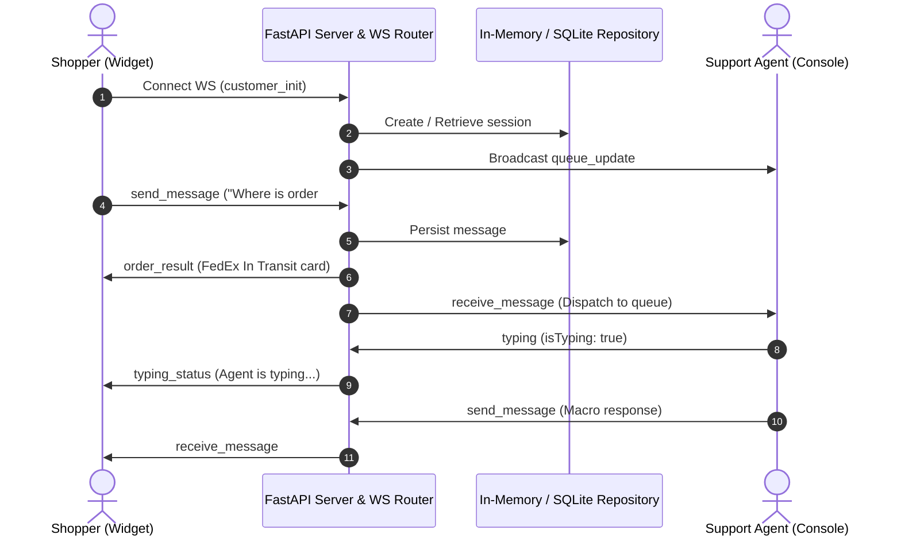

# Product Specification: Real-Time E-Commerce Customer Support Platform

**Document Version**: 1.1.0  
**Status**: Approved  
**Author**: Product Manager (@pm)  
**Governance**: Aligns with [AGENTS.md](file:///home/deai/zoomcamp/myprojects/aidevtools/AGENTS.md) (Peer Review Criteria #1, #3, #5)

---

## 1. Problem Description & User Personas

### 1.1 The Problem
Modern e-commerce storefronts face high cart abandonment rates (averaging 70%) when shoppers cannot get immediate answers regarding:
1. Product sizing, compatibility, and availability.
2. Real-time shipping duration and parcel tracking.
3. Return and refund policies.

Traditional ticketing systems and email forms take hours or days, causing shoppers to leave without completing purchases.

### 1.2 Target Personas
- **The Online Shopper ("Guest/Customer")**: Wants instant answers with zero friction, quick lookup of order tracking without navigating away, and option to talk to a human agent.
- **The Customer Support Specialist ("Agent")**: Manages multiple concurrent customer inquiries, requires real-time customer typing previews to respond faster, needs one-click canned macros, and instant order lookup context.

---

## 2. Functional & Non-Functional Requirements

### 2.1 Functional Requirements
- **FR-1: Embeddable Floating Chat Widget**: Modern glassmorphic widget anchored to viewport bottom-right, responsive across desktop and mobile.
- **FR-2: Real-Time Bidirectional Messaging**: Native asynchronous WebSockets delivering messages with sub-100ms transport latency.
- **FR-3: Quick Inquiry Chips**: One-click actions for common questions (*"Track #ORD-1001"*, *"Return Policy"*, *"Shipping Times"*, *"Live Agent"*).
- **FR-4: Automated E-Commerce Order Tracking**: Real-time simulated query parsing (e.g. `#ORD-1001`) returning carrier, status, estimated delivery date, and timeline directly in chat.
- **FR-5: Multi-Chat Support Console**: 3-pane agent dashboard with real-time queue filters (`All`, `Queued`, `Active`, `Closed`), conversation claiming, live customer typing previews, and canned response macros.
- **FR-6: Session Persistence**: Automatic guest session persistence in browser `localStorage` with state restoration on page refresh.

### 2.2 Non-Functional Requirements
- **NFR-1: Performance**: Lightweight frontend footprint (<150KB bundle) to protect storefront Core Web Vitals; sub-100ms WebSocket message round-trip.
- **NFR-2: Reliability**: Automatic reconnect with exponential backoff algorithm on network drops.
- **NFR-3: Security**: Strict HTML/XSS message escaping, message length constraints, and CORS enforcement.
- **NFR-4: Accessibility**: High contrast WCAG AA color palettes, ARIA live regions (`role="log"`), and keyboard navigation.

---

## 3. Technology Stack & Component Architecture

| Component | Technology | Rationale |
| :--- | :--- | :--- |
| **Backend Service** | Python 3.10+ / FastAPI / Uvicorn | High-concurrency asynchronous event loop handling concurrent WebSockets |
| **Real-Time Protocol** | Native WebSockets (`fastapi.WebSocket`) | Zero protocol bloat, standardized JSON event envelope |
| **Frontend Framework** | Modern Vanilla JavaScript & CSS Design System | Zero compilation step; embeddable into any e-commerce framework without dependency conflicts |
| **API Contract** | OpenAPI 3.0.3 (`openapi.yaml`) | Strict schema definition for all REST endpoints and WebSocket protocols |
| **Containerization** | Docker & Docker Compose | Multi-container orchestration ensuring deterministic deployment |
| **CI/CD** | GitHub Actions | Automated linting, test suites, container builds, and deployment verification |

---

## 4. Data Flow Sequence

