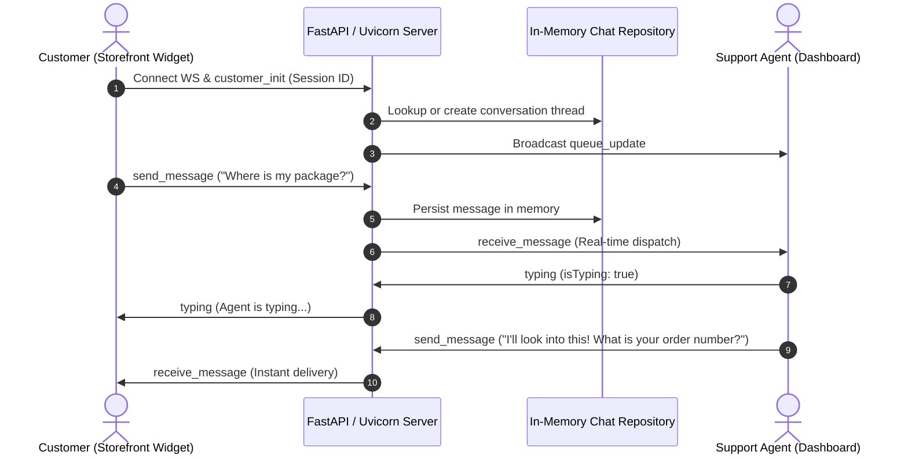

# Technical Specification: Real-Time E-Commerce Customer Support Chat System

**Document Version**: 1.1.0 (Updated: Python Architecture)  
**Status**: Pending User Approval  
**Role**: Product Manager (@pm) & Lead Architect  
**Target Output File**: `production_artifacts/Technical_Specification.md`

---

## 1. Executive Summary

This specification outlines the architecture, functional capabilities, and technical blueprint for a high-performance, real-time customer support chat application tailored for modern e-commerce storefronts.

Following user feedback to adopt **Python**, the backend is designed using **FastAPI / Uvicorn with asynchronous WebSockets**. This delivers a fast, low-latency, and event-driven foundation. The solution delivers an embeddable, lightweight customer chat widget alongside an intuitive, responsive Support Agent Dashboard. Designed for minimal latency and high availability, the platform allows shoppers to get instantaneous answers about product details, shipping, returns, and order status, while providing customer support representatives with real-time customer context, typing indicators, and canned responses.

---

## 2. System Requirements

### 2.1 Functional Requirements

#### A. Customer-Facing Experience (Chat Widget)
1. **Floating Chat Launcher & Responsive Drawer**:
   - Modern, unobtrusive floating badge anchored to the bottom-right of the viewport.
   - Expandable into a sleek glassmorphic chat modal with smooth transition animations.
   - Mobile-optimized full-screen or sheet view for smaller viewports.
2. **Session Initialization & Reconnection**:
   - Automatic guest customer session creation with persistent UUID stored in `localStorage`.
   - Automatic conversation history retrieval upon reconnection or page refresh.
3. **Real-Time Messaging**:
   - Instant bi-directional message exchange with sub-100ms transport latency over native WebSockets.
   - Message delivery states: Sent, Delivered, and Read.
   - Real-time live typing indicators ("Agent is typing...").
4. **E-Commerce Context & Quick Actions**:
   - Quick Action chips for instant inquiries: *"Where is my order?"*, *"Track a return"*, *"Product sizing help"*, *"Speak with human agent"*.
   - In-chat order lookup where customers enter an Order ID (e.g., `#ORD-1001`) to receive immediate simulated order shipping status.
5. **Agent Presence & Availability**:
   - Live status indicator (Online / Away / Estimated response time).

#### B. Support Agent Console
1. **Multi-Chat Queue & Conversation Management**:
   - Sidebar displaying all active, queued, and resolved customer sessions.
   - Unread message counters and visual alerts for new incoming customer inquiries.
2. **Contextual Customer Panel**:
   - Sidebar details showing customer identifier, session duration, and recent order lookups.
3. **Agent Productivity Tools**:
   - Canned responses (one-click macro snippets for greetings, shipping policies, return instructions).
   - Real-time customer typing preview (allowing the agent to prepare responses faster).
4. **Availability Status**:
   - Toggle agent status between "Online" and "Away" with dynamic queue routing.

---

### 2.2 Non-Functional Requirements

1. **Performance & Latency**:
   - WebSocket message transmission round-trip under 100ms with asynchronous Python (FastAPI / `uvicorn`).
   - Lightweight frontend assets (sub-150KB) to ensure zero impact on e-commerce storefront page performance and Core Web Vitals.
2. **Reliability & Resilience**:
   - Exponential backoff client reconnection logic.
   - Local client-side message queue to prevent dropped messages during transient network drops.
3. **UI/UX Aesthetics & Design System**:
   - Premium dark/light balanced theme with deep slate backdrop (`#0f172a`), royal indigo accents (`#6366f1`), emerald active badges (`#10b981`), and frosted glass borders (`rgba(255, 255, 255, 0.08)`).
   - Curated typography (Inter / Outfit).
4. **Security & Input Sanitization**:
   - Strict XSS escaping on all inbound text messages.
   - Message length guardrails (max 2,000 characters).

---

## 3. Architecture & Tech Stack

### 3.1 Recommended Technology Stack (Python-Centric)

| Layer | Recommended Technology | Justification |
| :--- | :--- | :--- |
| **Backend Runtime** | **Python 3.10+ with FastAPI & Uvicorn** | High-performance asynchronous ASGI framework; native async/await syntax enables handling thousands of concurrent WebSocket connections. |
| **Real-Time Protocol** | **Native WebSockets (`fastapi.WebSocket`)** | Zero third-party protocol overhead; standardized JSON messaging protocol with instant connection establishment and low resource footprint. |
| **Frontend Architecture** | **Modern Vanilla JS + CSS Design System** (Zero bloat) | Eliminates build tooling friction; cleanly embeds into any e-commerce storefront with zero framework clashes. |
| **Persistence / Cache** | **Async In-Memory Store with Clean Repository Pattern** | Out-of-the-box local execution with zero database dependencies required; cleanly isolated for straightforward SQLite or Redis integration. |
| **Static File Serving** | **FastAPI StaticFiles (`starlette.staticfiles`)** | Single unified service hosting the API, WebSockets, and static client/agent applications on a single port. |

---

### 3.2 Directory & Application Structure (`app_build/`)

```text
app_build/
├── server.py               # FastAPI application, WebSocket connection manager & routes
├── requirements.txt        # Python dependencies (fastapi, uvicorn, websockets)
├── static/
│   ├── index.html          # Demo E-Commerce Storefront with Embedded Widget
│   ├── agent.html          # Support Agent Management Dashboard
│   ├── css/
│   │   ├── widget.css      # Floating chat widget styles (glassmorphism, animations)
│   │   ├── agent.css       # Support agent console styles (multi-pane layout)
│   │   └── storefront.css  # Demo e-commerce store styling
│   └── js/
│       ├── widget.js       # Customer chat widget client logic & WebSocket handler
│       └── agent.js        # Support agent dashboard logic & queue management
└── lib/
    ├── __init__.py
    ├── chat_store.py       # In-memory session & message repository with lock-safe async methods
    └── mock_orders.py      # Simulated e-commerce order database & order status engine
```

---

### 3.3 WebSocket JSON Protocol & Message Types

All messages follow a standard envelope: `{ "type": "<EVENT_TYPE>", "payload": { ... } }`

| Event Type | Direction | Payload | Description |
| :--- | :--- | :--- | :--- |
| `customer_init` | Client $\to$ Server | `{ "customerId": "...", "name": "..." }` | Initializes or resumes customer chat session |
| `agent_join` | Agent $\to$ Server | `{ "agentId": "...", "agentName": "..." }` | Registers agent into active support pool |
| `send_message` | Either $\to$ Server | `{ "conversationId": "...", "sender": "...", "text": "..." }` | Transmits a chat message |
| `receive_message`| Server $\to$ Either | `{ "id": "...", "conversationId": "...", "sender": "...", "text": "...", "timestamp": "..." }` | Broadcasts message to room participants |
| `typing` | Either $\to$ Server | `{ "conversationId": "...", "sender": "...", "isTyping": bool }` | Updates typing state |
| `order_query` | Client $\to$ Server | `{ "orderId": "..." }` | Queries simulated e-commerce order |
| `order_result` | Server $\to$ Client | `{ "orderId": "...", "status": "...", "items": [...], "eta": "..." }` | Returns order details directly in chat |
| `queue_update` | Server $\to$ Agent | `{ "conversations": [...] }` | Broadcasts active queue status to agents |

---

## 4. State Management & Data Flow



---

## 5. UI/UX & Design Specifications

- **Theme**: Premium modern dark/light balanced theme with deep slate backdrop (`#0f172a`), royal indigo accents (`#6366f1`), emerald active badges (`#10b981`), and frosted glass borders (`rgba(255, 255, 255, 0.08)`).
- **Typography**: Clean geometric sans-serif stack (`Inter`, system-ui).
- **Accessibility**: Explicit ARIA roles (`role="log"`, `aria-live="polite"`), high contrast message bubbles, full keyboard navigation for message inputs and quick action buttons.

---

## 6. Verification & Quality Acceptance Criteria

1. **Local Boot**: `pip install -r requirements.txt && python server.py` (or `uvicorn server:app --port 8000`) starts the server cleanly.
2. **Storefront Demo**: Visiting `http://localhost:8000/` displays a simulated e-commerce product page featuring the live chat widget launcher.
3. **Agent Console**: Visiting `http://localhost:8000/agent.html` allows support agents to view incoming chats, claim conversations, and respond immediately.
4. **Order Status Feature**: Querying a demo order ID (e.g., `#ORD-1001`) returns automated order tracking data directly in the chat view.
5. **Real-Time Responsiveness**: Typing indicators and messages reflect instantly across two open browser windows (Customer window & Agent window).
